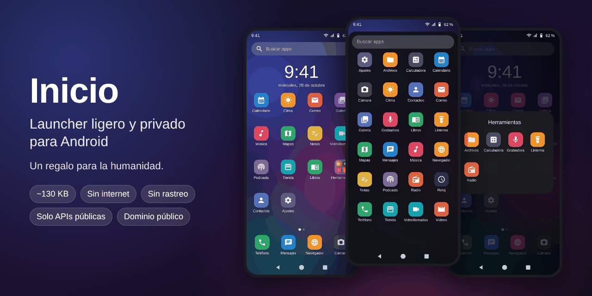
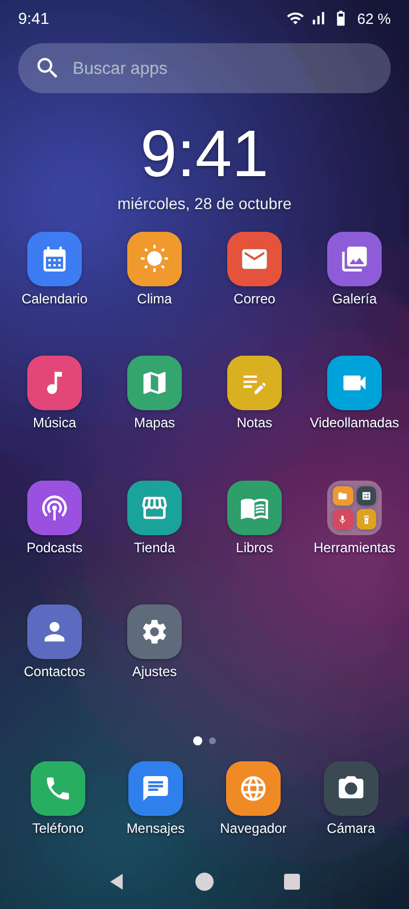
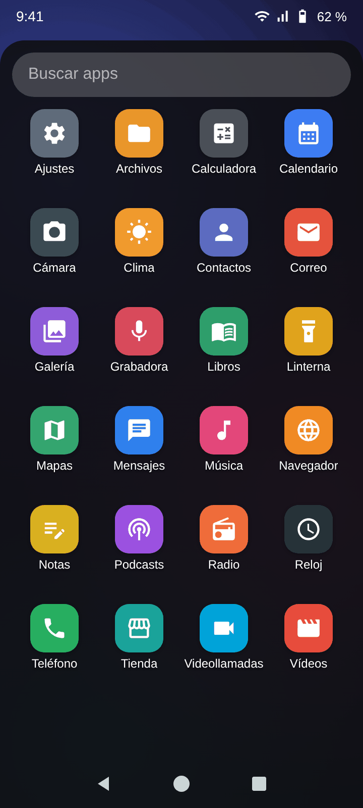
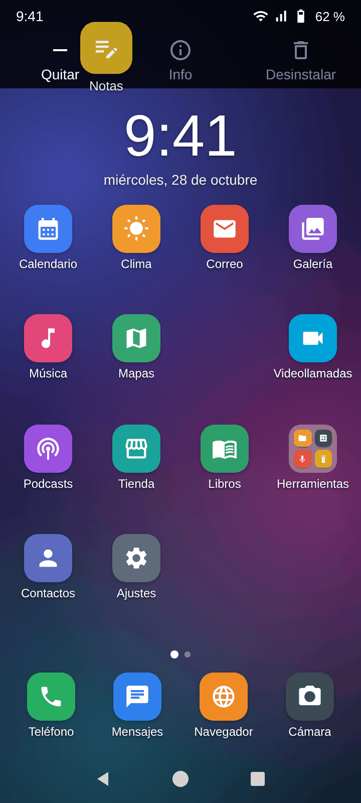
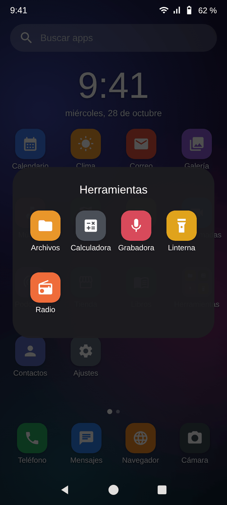

# Inicio — launcher ligero y privado para Android

[](https://github.com/web-gdl/Launcher_Xiaomi_A3/actions/workflows/main.yml)
[](LICENSE)


<p align="center">
  
</p>

> **Es un regalo para la humanidad.** Dominio público: úsalo, cópialo, modifícalo, compártelo o véndelo.
> No hace falta pedir permiso ni citar a nadie.

**Inicio** es una pantalla de inicio (*launcher*) hecha desde cero para un Xiaomi 24044RN32L con Android 16 (HyperOS),
y funciona en cualquier Android 8.0 o superior. Hace lo que se espera de un launcher y nada más:

- **Ligero:** el APK pesa unos **130 KB**. El de fábrica pesa 8,5 MB.
- **Privado:** no tiene permiso de internet, así que Android le impide conectarse a nada. Sin telemetría, sin anuncios y sin SDKs de terceros.
- **Limpio:** solo usa APIs públicas de Android. No necesita root, permisos de sistema ni ajustes ocultos.
- **Sencillo de mantener:** Java puro, sin Gradle, sin AndroidX y sin Kotlin. Se compila con cuatro herramientas (`aapt2 → javac → D8 → apksig`).

## Por qué existe

El launcher que trae el teléfono (GoLauncher de Xiaomi, `com.gogo.launcher` 5.0.4) ocupa 8,5 MB. Según un análisis de su APK,
incluye Firebase Analytics y Crashlytics y llamadas a servidores de estadísticas de Xiaomi. Parte de eso solo se activa si
participas en el programa de experiencia de usuario de MIUI.

Primero se intentó limpiarlo. No funcionó: ese launcher depende de permisos y funciones internas de Android que solo tiene la
copia firmada por Xiaomi, así que en cuanto se modifica deja de arrancar. Por eso se escribió este, desde cero y con lo justo.

## Así se ve

<p align="center">
  
  
  
  
</p>

| Escritorio | Cajón de apps | Arrastrar | Carpeta |
|---|---|---|---|
| Barra de búsqueda, páginas, widgets, carpetas y dock. | Todas las apps por orden alfabético, con búsqueda. Se abre deslizando hacia arriba. | La búsqueda se convierte en *Quitar / Info / Desinstalar*. | Suelta un icono sobre otro para crearla. |

<sub>Imágenes generadas a partir del diseño, con las mismas medidas y colores que el código y a 720×1600 como el teléfono.
Las apps, los iconos y el widget de reloj son de ejemplo: no son capturas del teléfono. La barra de estado y la de navegación
son las del sistema. Se regeneran con [`docs/preview/render.py`](docs/preview/).</sub>

## Estado

**Versión 0.1.3** (octubre de 2026). Compila, se firma, pasó dos revisiones de código independientes y se instala en el
Xiaomi 24044RN32L. Las pruebas de uso diario en el teléfono están en curso.
El historial está en [`CHANGELOG.md`](CHANGELOG.md).

Si algo falla, el registro se saca con `adb logcat -d -b crash -b main > log.txt`. Abre un *issue* con él.

## Funciones

| Función | Cómo se usa |
|---|---|
| Escritorio con varias páginas | Desliza a izquierda y derecha. Los puntos de abajo indican la página. |
| Búsqueda | Barra «Buscar apps» arriba del escritorio: abre el cajón con el teclado listo. El cajón tiene el mismo campo arriba. |
| Dock (4 apps fijas) | Fila inferior. Arrastra apps dentro y fuera. |
| Cajón de todas las apps | **Desliza hacia arriba** desde cualquier parte (escritorio, dock o puntos de página). Se cierra deslizando hacia abajo con la lista arriba del todo, con Atrás o con Inicio. |
| Mover iconos y widgets | **Mantén pulsado** y arrastra. Cerca del borde cambia de página; en la última página crea una nueva. |
| Quitar del inicio / Info / Desinstalar | Al arrastrar, la barra de búsqueda se convierte en estas tres opciones: suelta encima de una. Quitar no desinstala: la app sigue en el cajón. |
| Carpetas | Suelta un icono sobre otro (también en el dock). Toca la carpeta para abrirla y cambiarle el nombre. Mantén pulsada una app dentro para sacarla. |
| Añadir una app al inicio | En el cajón, mantén pulsada la app → «Añadir al inicio». |
| Atajos de las apps | En el cajón, mantén pulsada la app: aparecen sus atajos (p. ej. «Nuevo mensaje»). |
| Widgets | Mantén pulsada una **zona vacía** del escritorio → «Widgets». |
| Fondo de pantalla | Zona vacía → «Fondo de pantalla» (abre el selector del sistema). |
| Insignias de notificación | Solo en la variante «insignias» (ver «Instalar»): Ajustes del inicio → «Activar insignias» y concede el acceso a notificaciones. |
| Ajustes | Zona vacía → «Ajustes del inicio»: columnas, filas, tamaño de iconos, nombres y restablecer. |
| Barra de notificaciones | Desliza hacia abajo en el escritorio o el dock. Usa una función no documentada de Android; si el sistema la bloquea, no hace nada. |

Las apps que instales después aparecen solas al final del escritorio, y las que quites del inicio no vuelven a aparecer.
Si reduces columnas o filas, los iconos que ya no caben se recolocan en el primer hueco libre: no se pierde ninguno.

## Descargar

| Archivo | Para qué sirve |
|---|---|
| **[launcher-movil.apk](https://github.com/web-gdl/Launcher_Xiaomi_A3/raw/main/descargas/launcher-movil.apk)** | **Empieza por aquí.** Se instala desde el gestor de archivos. No tiene insignias de notificación. |
| [launcher-movil-insignias.apk](https://github.com/web-gdl/Launcher_Xiaomi_A3/raw/main/descargas/launcher-movil-insignias.apk) | Igual, con insignias. Se instala con `adb install -r` (ver «Instalar»). |
| [SHA256SUMS.txt](https://github.com/web-gdl/Launcher_Xiaomi_A3/raw/main/descargas/SHA256SUMS.txt) | Sumas de verificación. |

Los APK están en la carpeta [`descargas/`](descargas) (también se publicarán en [Releases](https://github.com/web-gdl/Launcher_Xiaomi_A3/releases)). Van
firmados con la clave del autor, así que cada versión se instala encima de la anterior sin perder la disposición del escritorio.

## Instalar

Hay dos variantes con el mismo paquete y la misma firma, así que se puede pasar de una a otra instalando encima:

| APK | Insignias | Cómo instalarla |
|---|---|---|
| `launcher-movil.apk` | No | Desde el gestor de archivos o con adb. |
| `launcher-movil-insignias.apk` | Sí | Con `adb install -r`. Google Play Protect bloquea la instalación desde navegador, mensajería o gestor de archivos de las apps que piden acceso a notificaciones (protección contra fraude). |

1. Copia `launcher-movil.apk` al teléfono y ábrelo, o usa `adb install -r launcher-movil.apk`.
2. Ve a **Ajustes → Apps → Apps predeterminadas → Pantalla de inicio** y elige **«Inicio»**.
3. En el primer arranque coloca todas tus apps en el escritorio por orden alfabético. Las de teléfono, mensajes, navegador y cámara van al dock.

**No desactives el launcher de fábrica.** HyperOS lo sigue usando para la pantalla de Recientes y los gestos de navegación,
como con cualquier launcher que no venga de fábrica.

## Volver al launcher de fábrica

Ajustes → Apps → Apps predeterminadas → Pantalla de inicio → el de fábrica. Para quitarlo del todo:
```
adb uninstall com.webgdl.launcher
```

## Privacidad y permisos

Solo pide tres permisos, ninguno de red:

| Permiso | Para qué |
|---|---|
| `QUERY_ALL_PACKAGES` | Ver las apps instaladas (imprescindible para un launcher). |
| `EXPAND_STATUS_BAR` | Bajar la barra de notificaciones al deslizar hacia abajo. |
| `REQUEST_DELETE_PACKAGES` | Abrir el diálogo de desinstalación del sistema. Siempre confirmas tú. |

- Sin el permiso `INTERNET`, Android le impide abrir cualquier conexión.
- La disposición del escritorio se guarda solo en el teléfono, en `layout.json` dentro de los datos privados de la app.
- Las insignias usan el acceso a notificaciones solo para **contar** cuántas tiene cada app. No leen su contenido ni guardan nada,
  y solo funcionan si concedes ese acceso, que puedes retirar cuando quieras.

## Límites conocidos (v0.1.3)

- Recientes y gestos de navegación los gestiona el sistema, no este launcher.
- Los atajos de las apps solo aparecen cuando «Inicio» es la pantalla de inicio predeterminada: Android no deja consultarlos a otro launcher.
- Las apps no pueden fijar accesos directos en el inicio (p. ej. «Añadir a la pantalla de inicio» desde un navegador).
- Las apps del cajón no se arrastran directamente al escritorio: se usa «Añadir al inicio».
- Los widgets no se pueden redimensionar; ocupan el tamaño que pide cada uno.
- Si un widget no se puede cargar (p. ej. tras actualizar su app), aparece un recuadro «Widget no disponible». Se vuelve a intentar al recargar y se puede quitar arrastrándolo.
- La variante normal no tiene insignias de notificación (ver «Instalar»).

## Compilar

Requisitos: JDK 17 o superior, `curl`, `unzip` y `zip`.

```bash
./tools/get-tools.sh             # descarga android-36.jar, aapt2 y jadx (D8 + apksig) en tools/
./build.sh                       # -> out/launcher-movil.apk (sin insignias)
./build.sh --variant insignias   # -> out/launcher-movil-insignias.apk
./build.sh --variant ambas       # las dos
```

Si no existe, la compilación crea una clave de firma en `keystore/release.p12` (alias `launcher`; contraseña: la variable `KSPASS`,
o la de `build.sh` si no la defines). **Guárdala:** sin ella no podrás instalar versiones nuevas encima de la instalada.
Si compilas tu propia versión, usa tu propia clave: los APK de Releases van firmados con la del autor.

## Publicar versiones (mantenimiento)

Cada push compila el proyecto en GitHub Actions ([`main.yml`](.github/workflows/main.yml)). Esos APK de prueba usan una clave temporal,
así que **no** se pueden instalar encima de una versión de Releases.

Para publicar una versión ([`release.yml`](.github/workflows/release.yml)):

1. Una sola vez, en *Settings → Secrets and variables → Actions*, crea los secretos:
   - `KEYSTORE_BASE64`: el resultado de `base64 -w0 keystore/release.p12` (da igual si se pega con saltos de línea)
   - `KEYSTORE_PASSWORD` (opcional): la contraseña del almacén, solo si no es la predeterminada de `build.sh`
2. Sube `android:versionCode` y `android:versionName` en `AndroidManifest.xml`, pon la misma versión en `VERSION` y anota los cambios en `CHANGELOG.md`.
3. Haz push a `main`. Se crea la etiqueta `vX.Y.Z` y una Release con los dos APK y `SHA256SUMS.txt`.
   También se puede lanzar a mano en *Actions → Publicar APK → Run workflow*.

El flujo comprueba que la clave abre con esa contraseña y muestra la huella SHA-256 del certificado en el registro.
Al terminar descarga los APK desde los enlaces fijos de «Descargar» y compara sus sumas: si un enlace no funciona, el flujo falla.
Si falta `KEYSTORE_BASE64`, termina sin publicar y lo avisa, para no subir nunca APK firmados con otra clave.
La clave (`keystore/`) no se sube nunca al repositorio.

## Estructura

```
AndroidManifest.xml        Actividad HOME, ajustes y servicio de insignias. Sin INTERNET.
res/                       Colores, textos, iconos vectoriales, fondos y temas.
src/com/webgdl/launcher/
  HomeActivity.java        Pantalla de inicio: escritorio, dock, cajón, carpetas, widgets, arrastre, carga y guardado.
  PagedView.java           Páginas del escritorio (deslizar a los lados) y pulsación larga en zona vacía.
  CellLayout.java          Cuadrícula de celdas.
  BubbleTextView.java      Icono + nombre + insignia.
  FolderIcon.java          Icono de carpeta con miniaturas 2×2.
  Folder.java              Carpeta abierta.
  AllAppsContainer.java    Cajón con búsqueda.
  OptionsPopup.java        Menú al mantener pulsada una app del cajón.
  DragController.java      Copia flotante durante el arrastre.
  DragLayer.java           Contenedor raíz: arrastre y deslizamientos arriba/abajo desde cualquier parte.
  LauncherWidgetHost.java  Widgets, con su propia detección de pulsación larga.
  LauncherModel.java       Lista de apps (LauncherApps) y guardado de la disposición en JSON (un único hilo de disco).
  IconCache.java           Carga de iconos en segundo plano con caché LRU.
  BadgeNotificationListener.java + BadgeCache.java   Insignias.
  SettingsActivity.java + Prefs.java                 Ajustes.
  Utilities.java           Medidas, iconos y márgenes de las barras del sistema.
docs/preview/render.py     Genera las imágenes de este README.
```

## Licencia

**Es un regalo para la humanidad.** Este proyecto es de dominio público ([The Unlicense](LICENSE)).
Cualquiera puede copiarlo, modificarlo, publicarlo, usarlo, compilarlo o venderlo, con cualquier fin y por cualquier medio,
sin pedir permiso y sin citar a nadie. Se entrega tal cual, sin garantías.

**Créditos de terceros.**
- Algunos iconos vectoriales de la app (buscar, ajustes, información, borrar, etc.) y los glifos de las imágenes de ejemplo vienen
  de [Material Icons](https://github.com/google/material-design-icons) (Google, Apache 2.0).
- Las imágenes usan la letra [Roboto](https://github.com/googlefonts/roboto) (Apache 2.0).
